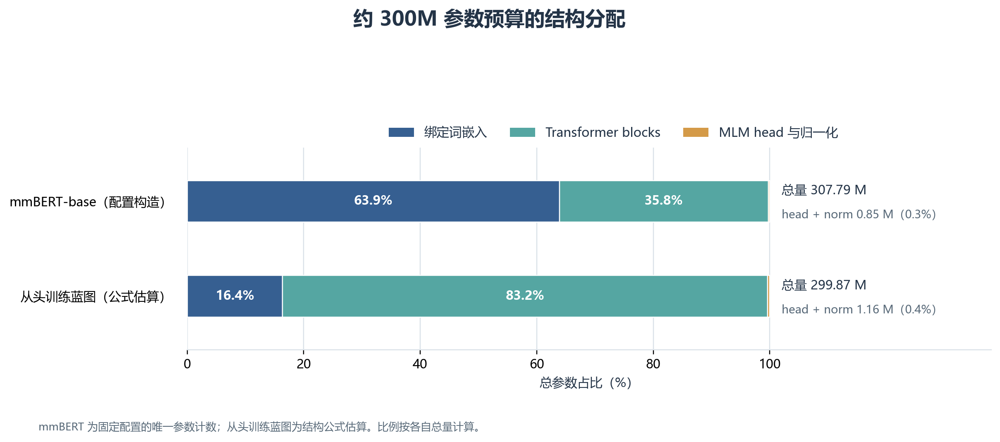
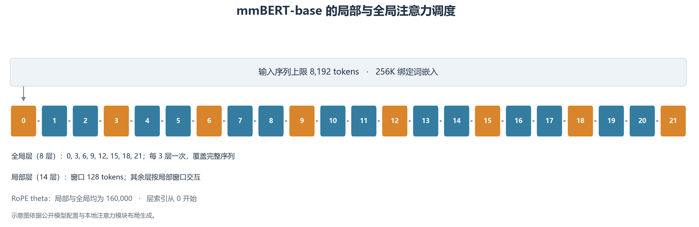

# 面向中英长文本理解的架构预算与缩比验证

本次实验的代码及相关说明可在该仓库中获取：[https://github.com/stq1234/LLMandAppliedPractices-NextBERT](https://github.com/stq1234/LLMandAppliedPractices-NextBERT)。

## 摘要

本文设计一条面向中英分类、抽取、检索与重排任务的 8K 双向编码器方案，并分析约 300M 参数预算在词嵌入和编码器层之间的分配。方案以公开 mmBERT-base 模型配置为架构参照，另建立同规模从头训练蓝图；预训练采用动态 token MLM 和连续 span MLM，下游设置包括序列分类、边界式抽取、双编码器检索与交叉编码器重排。程序采用随机初始化缩比模型核验结构和数值行为。固定配置对应 307,786,240 个唯一参数，其中绑定词嵌入占 63.9%、Transformer blocks 占 35.8%；从头训练蓝图估算为 299,870,080 个参数，其中 blocks 占 83.2%。缩比检查覆盖两种 MLM 掩码路径、四类任务头及 8K 输入前向，为架构预算与任务接口提供了可复核证据。

**代码仓库：[https://github.com/stq1234/LLMandAppliedPractices-NextBERT](https://github.com/stq1234/LLMandAppliedPractices-NextBERT)。本次实验的代码及相关说明可在该仓库中获取。**

## 1. 研究问题与设计框架

双向编码器以同一序列的上下文表示支持多种判别任务。面向中文与英文长文本，模型设计需要同时安排词表嵌入、注意力交互范围和任务输出形式。本文关注的设计问题是：在约 300M 参数、最大长度 8,192 的边界内，如何构成一套适合分类、抽取、检索及重排的编码器，并使各任务的训练目标与输出结构相互匹配。

主方案拟以公开预训练 mmBERT-base 为适配起点，以其模型配置和 tokenizer 定义编码器结构、词表规模及特殊 token 语义；从头训练蓝图提供近似参数总量下的另一种容量分配。本文的大模型参数统计依据公开配置构造模块。mmBERT-base 的多语训练背景及 ModernBERT 风格结构为该架构参照提供依据。[1,2] 模型配置见 [mmBERT-base 模型配置](https://huggingface.co/jhu-clsp/mmBERT-base)。

## 2. 方法设计

### 2.1 编码器结构与参数预算

架构参照包含 256,000 项绑定输入/输出词嵌入、22 层编码器、768 维隐藏状态、12 个注意力头及每个 GeGLU 分支 1,152 维，最大位置长度为 8,192。局部注意力窗口为 128 token，并每三层设置一层全局注意力。全局层索引为 0、3、6、9、12、15、18、21，共 8 层；其他 14 层使用局部注意力。局部和全局 RoPE theta 均为 160,000。编码器采用 pre-norm LayerNorm 与 GeGLU，并绑定输入与 MLM 输出嵌入。

图 1 以同一参数总量尺度展示预训练适配路线与从头训练路线如何分配词表和编码器容量。mmBERT-base 数量由 Transformers ModernBERT 模型类按配置在 meta device 上构造后统计唯一参数，绑定的输入/输出嵌入只计一次；从头训练蓝图依参数公式估算。

**图 1. 约 300M 参数预算的组成。** mmBERT-base 为配置构造统计，从头训练蓝图为公式估算。

从头训练候选采用 28 层、1,024 维隐藏状态、16 个注意力头、每个 GeGLU 分支 1,536 维和 48,000 项绑定词表。按每层 4H² 注意力参数和 3H·I GeGLU 参数估算，再计入嵌入、MLM head 与归一化参数，得到 299,870,080 个参数。

**表 1. 两种约 300M 参数架构的组件预算。**

| 参数组件 | mmBERT-base 配置 | 占比 | 从头训练蓝图 | 占比 |
|---|---:|---:|---:|---:|
| 绑定词嵌入 | 196,608,000 | 63.9% | 49,152,000 | 16.4% |
| Transformer blocks | 110,330,112 | 35.8% | 249,561,088 | 83.2% |
| MLM head 与归一化 | 848,128 | 0.3% | 1,156,992 | 0.4% |
| **合计** | **307,786,240** | **100.0%** | **299,870,080** | **100.0%** |

图 2 展示了 22 层编码器中局部与全局注意力的位置。局部层将每层直接交互限制在 128-token 窗口，周期性全局层使整段输入的信息可进入同一注意力层。

**图 2. 22 层编码器的注意力拓扑。** 橙色为全局注意力层，蓝色为窗口长度 128 token 的局部注意力层；层索引从 0 开始。

### 2.2 双向编码器的注意力与前馈结构

设输入序列包含 $n$ 个 token，当前编码层的输入隐状态矩阵为 $X\in\mathbb{R}^{n\times H}$，隐藏维度为 $H$，注意力头数为 $A$，每头维度为 $d_h=H/A$。同一编码序列产生查询、键和值；每个注意力头按缩放点积计算上下文加权和，再拼接并线性投影：

$$
\begin{aligned}
Q_a &= XW_Q^{(a)},\\
K_a &= XW_K^{(a)},\\
V_a &= XW_V^{(a)},\\
S_a &= \frac{Q_aK_a^\top}{\sqrt{d_h}}+B^{(\ell)},\\
\operatorname{head}_a &= \operatorname{softmax}(S_a)V_a,\\
\operatorname{MHA}(X) &=
  \operatorname{Concat}(\operatorname{head}_1,\ldots,\operatorname{head}_A)\\
  &\qquad W^O.
\end{aligned}
$$

矩阵 $B^{(\ell)}$ 是加到注意力分数上的结构掩码：允许参与的键位置取 0，被屏蔽的位置取 $-\infty$，从而在 softmax 后权重为零。双向编码器不施加因果三角掩码，所以任何有效位置都可利用其左侧和右侧上下文；限制来自 padding 和具体层的局部窗口。多头投影让不同子空间分别形成 token 间的加权关系，输出仍回到 $H$ 维以便残差相加。

标准 Transformer 编码器以残差连接包围注意力和逐位置前馈子层，并在相加后归一化。BERT 沿用双向 Transformer 编码器，使用 GELU 前馈层；与自回归模型的因果掩码不同，它以掩码语言模型从左右上下文预测被选 token。[9,10] 逐位置前馈映射为：

$$
\begin{aligned}
\operatorname{FFN}_{\mathrm{BERT}}(X)
  &= \operatorname{GELU}(XW_1+b_1)W_2+b_2,\\
X_{\mathrm{attn}} &= \operatorname{LN}(X+\operatorname{MHA}(X)),\\
U &= X_{\mathrm{attn}}
  +\operatorname{FFN}_{\mathrm{BERT}}(X_{\mathrm{attn}}),\\
X' &= \operatorname{LN}(U).
\end{aligned}
$$

这里的层归一化在单个 token 的 $H$ 个特征维上计算均值 $\mu_H$ 和标准差 $\sigma_H$，$\gamma$、$\beta$ 为可学习逐维参数，具体映射为：

$$
\operatorname{LN}(x)=\gamma\odot\frac{x-\mu_H}{\sqrt{\sigma_H^2+\epsilon}}+\beta.
$$

它将子层输入尺度标准化，残差项则保留输入的直接通路。mmBERT 所参照的 ModernBERT 块采用 pre-norm：先归一化子层输入，再将子层输出加回残差流。其 GELU 门控线性单元 GeGLU 可写为：

$$
\begin{aligned}
X_{\mathrm{attn}} &= X+\operatorname{MHA}(\operatorname{LN}(X)),\\
\operatorname{GeGLU}(X) &=
  \left[\operatorname{GELU}(XW_g)\odot(XW_v)\right]W_o,\\
X' &= X_{\mathrm{attn}}+
  \operatorname{GeGLU}(\operatorname{LN}(X_{\mathrm{attn}})).
\end{aligned}
$$

式中 $W_g,W_v\in\mathbb{R}^{H\times I}$、$W_o\in\mathbb{R}^{I\times H}$，$\odot$ 表示逐元素乘法，$I$ 是单个门控分支的维度。固定 mmBERT 配置关闭注意力和 MLP 线性偏置，因此每层注意力约含 $4H^2$ 个权重，GeGLU 含 $3HI$ 个权重；$I=1{,}152$ 是每个分支的宽度。相同宽度的两个输入投影分别形成内容变换和门控信号，逐元素相乘后再投影回隐藏空间。这也解释了表 1 中的 Transformer blocks 参数组成。

该配置不在输入嵌入中添加传统的绝对位置向量，而将旋转位置嵌入 RoPE 施加到每个注意力头的查询和键上。令 $p$ 为 token 位置，$m$ 为二维旋转频率索引，频率为 $\omega_m$，位置 $p$ 对应的旋转矩阵为 $R_p$，则：

$$
\begin{aligned}
\omega_m &= \theta^{-2m/d_h},\\
q'_i &= R_iq_i,\\
k'_j &= R_jk_j,\\
(q'_i)^\top k'_j &= q_i^\top R_{j-i}k_j.
\end{aligned}
$$

因此，注意力内积同时依赖内容和相对位移 $j-i$。局部层使用对称窗口，全局层不限制有效 token 间的距离。按零起始层号 $\ell$，当前固定配置的允许键集合可表示为：

$$
\mathcal{A}_{\ell}(i)=
\begin{cases}
\{j:a_j=1\}, & \ell\bmod 3=0,\\
\{j:a_j=1\ \land\ |i-j|\leq 64\}, & \ell\bmod 3\neq 0.
\end{cases}
$$

其中 $a_j=1$ 表示非 padding 位置。固定配置的局部窗口参数为 128；实现将其分为左右各 64 个位置。22 层中索引 0、3、6、9、12、15、18、21 为全局层，其余 14 层为局部层。局部层仍是双向注意力，窗口外的信息需经后续全局层传递。ModernBERT 论文报告的局部 RoPE theta 为 10,000、全局为 160,000；本文采用的固定 mmBERT revision 配置两者均为 160,000，故图 2 和参数分析以该公开配置为准。[2,3,11,12]

### 2.3 预训练目标

作为预训练参照，原始 BERT 每条序列随机选择 15% 的 WordPiece 位置作为 MLM 目标，并按 80% 替换为 MASK、10% 替换为随机 token、10% 保留原 token 的规则构造输入；原始训练还联合了下一句预测（NSP）。MLM 只在被选择的位置上计算原 token 的交叉熵：

$$
\begin{aligned}
\boldsymbol{\ell}_i &= W_{\mathrm{vocab}}h_i+b_{\mathrm{vocab}},\\
p_{\theta}(x_i\mid\widetilde{\boldsymbol{x}})
  &= \operatorname{softmax}(\boldsymbol{\ell}_i)_{x_i},\\
\lambda_i &= -\log p_{\theta}(x_i\mid\widetilde{\boldsymbol{x}}),\\
\mathcal{L}_{\mathrm{MLM}}
  &= \frac{1}{|S|}\sum_{i\in S}\lambda_i.
\end{aligned}
$$

其中 $\widetilde{\boldsymbol{x}}$ 是扰动后的输入，$S$ 为预测位置集合，$x_i$ 是扰动前的目标 token，$h_i$ 是编码器在该位置的输出。本文的 NextBERT 方案仍采用这一 token 级恢复接口，但目标比例设为有效普通内容 token 的 30%；token MLM 无放回抽取离散位置，span MLM 抽取长度 1–4 的连续片段并将原 token 作为标签，两者都使用相同的 80/10/10 输入扰动和 MLM 输出层。本设计不加入 NSP 目标，固定 mmBERT 配置将 MLM 输出权重与输入词嵌入绑定。BERT 的 15% 是原论文基线，不是本方案或缩比程序的掩码率；缩比代码的随机替换仅从合成词表 ID 区间 [10,512) 抽样。该 span 目标只在连续位置上执行 MLM，不包含 SpanBERT 的边界表征预测目标。[4,10]

### 2.4 下游任务表示与损失

令最终 token 表示为 $h_i$，attention mask $a_i$ 对非 padding token 取 1。分类和检索中的 masked mean pooling、分类 logits 与交叉熵为：

$$
\begin{aligned}
\bar h &= \frac{\sum_{i=1}^{n}a_i h_i}
              {\max(1,\sum_{i=1}^{n}a_i)},\\
z &= W_c\bar h+b_c,\\
\mathcal{L}_{\mathrm{cls}} &= \operatorname{CE}(z,y).
\end{aligned}
$$

分类头对最终层的有效 token 表示作 masked mean pooling，再通过线性层产生三个类别的 logits，以交叉熵训练。这里的 attention mask 排除 padding；特殊 token 仍属于有效输入位置。序列级汇总将共享编码器表示映射为文档或句子标签。

抽取头为每个 token 输出 start 与 end 两个分数；padding 和 tokenizer 特殊 token 位置不参与边界 softmax。令 $s_i,e_i$ 为两个边界分数，$i_s,i_e$ 为 gold 起止位置，则训练损失为：

$$
\begin{aligned}
\begin{bmatrix}s_i\\e_i\end{bmatrix} &= W_eh_i+b_e,\\
\mathcal{L}_{\mathrm{span}}
  &= \operatorname{CE}(\boldsymbol{s}_{\mathrm{valid}},i_s)\\
  &\qquad+\operatorname{CE}(\boldsymbol{e}_{\mathrm{valid}},i_e).
\end{aligned}
$$

该形式直接预测输入中的连续答案跨度，适合答案可从上下文定位的抽取式问答。合成验证样本在有效内容位置构造连续 gold span。

检索头采用共享双编码器表示：同一句输入经过两次独立 dropout，masked mean pooling 后经共享线性投影并作 L2 归一化。令 $z_i^{(1)},z_i^{(2)}$ 为两视图句向量，批大小为 $B$，温度 $\tau=0.07$，则相似度与对角线正例的批内对比损失为：

$$
\begin{aligned}
S_{ij} &= \frac{(z_i^{(1)})^\top z_j^{(2)}}{\tau},\\
\mathcal{L}_{\mathrm{ret}}
  &= \operatorname{CE}(S,(0,1,\ldots,B-1)).
\end{aligned}
$$

该设置沿用无监督 SimCSE 的双视图思路；独立编码产生的句向量可预先计算和索引，适合作为候选检索的第一阶段。[5,6]

重排头把文本对以 BOS、SEP 标记拼接后共同输入编码器，对有效 token 表示作 masked mean pooling，再由线性层输出一个相关性分数。令拼接后的池化表示为 $\bar h_{q,d}$，相关标签为 $r\in\{0,1\}$，则：

$$
\begin{aligned}
u &= w_r^\top\bar h_{q,d}+b_r,\\
\sigma(u) &= \frac{1}{1+\exp(-u)},\\
\mathcal{L}_{\mathrm{rank}} &=
  -r\log\sigma(u)\\
  &\qquad-(1-r)\log\!\left(1-\sigma(u)\right).
\end{aligned}
$$

交叉编码器在打分前联合建模两个文本的 token 交互，适合对初步检索候选进行精排；双编码器则可预先计算文档向量并通过相似度查询召回，因此两类编码方式分别服务候选召回与精排。[7]

程序的合成多任务检查将分类、抽取、检索与重排四项损失直接相加，以未加权总损失联合更新共享编码器和四个任务头；两种 MLM 损失分别执行独立更新。该检查覆盖多任务共享参数的一次联合梯度路径。这组输出形式覆盖序列标签、token 边界、向量相似度与文本对相关性等互补粒度。

## 3. 缩比验证

主要功能检查使用 ModernBertForMaskedLM，包含 4 层、64 维隐藏状态、4 个注意力头、每个 GeGLU 分支 96 维、512 项词表、局部窗口 8、每三层一次全局注意力及 0.1 dropout，共 177,280 个参数；批次由 3 条长度 18 的随机 token 序列组成，并含 BOS、SEP 与右侧 padding。MLM 可预测位置排除 special ID {0,1,2,3,4,106,107}。CPU 运行使用 Python 3.12.7、PyTorch 2.12.0+cu126、Transformers 4.51.3，线程数为 2；token 与 span MLM 掩码率为 30%，AdamW 学习率为 0.001。

缩比检查记录 MLM 与下游任务损失、梯度和参数更新，并核对有效 token 与 special ID 规则、任务输出形式及 eval 确定性。另设 8K 输入探针，模型为 3 层、16 维隐藏状态、1 个注意力头、intermediate size 24、局部窗口 128、每三层一次全局注意力，共 15,616 个参数，使用 SDPA 在 CPU 上对长度 8,192 的序列执行前向计算。mmBERT-base 的 307,786,240 参数来自固定公开配置构造后的模块计数，输入/输出绑定嵌入按唯一参数计一次；该统计描述配置对应的结构规模。从头训练架构是约 300M 的公式蓝图。实际梯度检查和 8K 前向使用随机初始化缩比模型及合成 token，验证了结构、损失接口、梯度更新和目标长度张量路径的可执行性；任务效果由下游语料评测确定。

## 4. 结果

配置统计表明，mmBERT-base 为 307,786,240 个唯一参数，比 300M 高约 2.6%；词嵌入占 63.9%，编码器 blocks 占 35.8%。从头训练蓝图估算为 299,870,080 个参数，其中编码器 blocks 占 83.2%、嵌入占 16.4%。相近的总量对应不同的能力分配：预训练适配路线保留宽词表嵌入规模，从头训练蓝图将更多容量投入编码器深度与宽度。

**表 2. 缩比验证结果及其对应的模型语义。**

| 验证性质 | 观察结果 | 对应的模型语义 |
|---|---|---|
| 动态 token MLM 与连续 span MLM | 合成序列上的两条掩码路径均产生有限损失与梯度，且更新编码器注意力参数；选中目标来自有效内容位置 | 分散词项恢复与连续片段恢复共享 MLM 输出接口，目标 token 由输入有效位及 special-ID 规则界定 |
| 分类与抽取 | 两个任务头均产生有限损失，编码器与任务头均获得非零梯度并更新 | 序列池化支持类别判别，token 级 start/end 预测支持上下文内连续跨度抽取 |
| 双编码器检索与交叉编码器重排 | 两视图对比损失与合成文本对的二元交叉熵均为有限值；联合更新覆盖编码器及各任务头 | 共享句向量用于批量候选检索，文本对联合编码用于候选相关性精排 |
| 有效 token 与推理行为 | masked mean pooling 按 attention mask 汇总；抽取目标来自有效位置；eval 重复输出一致 | 序列级与 token 级读出均以输入有效位定义内容表示 |
| 8K 长度路径 | 15,616 参数、3 层、隐藏维度 16 的 SDPA 模型完成长度 8,192 的 CPU 前向 | 缩比编码器结构可处理目标上下文长度 |

## 5. 讨论

**词表预算与编码器容量。** 256K 词表支持复用 mmBERT-base 的多语 tokenizer 与对应嵌入，但也占据约 64% 的总参数预算。48K 从头训练蓝图把嵌入占比降至约 16%，从而将约 83% 参数分配给编码器 blocks。较小词表可释放参数用于增加层数或隐藏宽度；相应地，词项切分、稀有中英文专名表示和嵌入学习负担也会改变。两条路线的关键取舍因而是沿用成熟 tokenizer/嵌入结构，还是以更高编码器容量交换重新学习词表表示。

**局部与全局交互。** 对长度为 n 的序列，全局注意力每层的 token 交互随 n² 增长，固定窗口 w 的局部注意力则随 n·w 增长。当前布局在 22 层中安排 8 个全局层与 14 个局部层，在保留周期性跨段通信的同时减少需要全序列交互的层数。相较逐层全局注意力，该安排为长上下文提供更低的全局交互密度；局部层的直接 token 交互限定于窗口内，窗口外证据依靠全局层间接传递。任务若依赖稀疏、远距离证据，稀疏全局层的频率与窗口长度将直接决定交互路径。

**抽取式与生成式问答。** 双边界抽取头直接在输入中选择连续起止位置，输出紧凑、训练目标明确，适合答案可在证据文本中定位的任务；它的预测空间由输入中的连续片段构成，改写、归纳和证据外知识回答适合由生成式输出完成。text-to-text 路线将答案表示为输出序列并整合多个证据片段，以生成目标逐 token 解码。[8] 因此，start/end 头服务证据抽取，生成式解码器服务答案组织与文本生成。

**检索与重排的级联。** 双编码器把查询与文档映射至共享向量空间，可缓存文档向量并以相似度快速筛选候选；其独立编码压缩了跨文本 token 交互。交叉编码器对候选对联合注意，可利用细粒度对齐信息，但必须逐对计算。将双编码器用于召回、交叉编码器用于精排，体现了检索规模与交互精度之间的结构分工；此职责划分与两种实现的输入和输出形式一致。

## 6. 结论

本文形成了一套围绕中英文长上下文判别任务的编码器设计：以 mmBERT-base 配置为预训练适配架构参照，以局部/全局混合注意力承载 8K 输入，并用 token/span MLM、序列分类、边界抽取、双编码器检索和交叉编码器重排覆盖不同粒度的监督信号。参数预算统计显示，宽词表适配方案与小词表从头训练方案总量接近，但分别将参数集中于嵌入和编码器 blocks。功能检查中，两类 MLM 路径及四类任务头均按定义形成有限损失与梯度，8K 缩比模型完成目标长度前向计算。

## 参考文献

1. Marone, M., et al. “mmBERT: A Modern Multilingual Encoder with Annealed Language Learning.” [arXiv:2509.06888](https://arxiv.org/abs/2509.06888).
2. Warner, B., et al. “Smarter, Better, Faster, Longer: A Modern Bidirectional Encoder for Fast, Memory Efficient, and Long Context Finetuning and Inference.” [arXiv:2412.13663](https://arxiv.org/abs/2412.13663).
3. Johns Hopkins CLSP. [mmBERT-base 模型配置](https://huggingface.co/jhu-clsp/mmBERT-base).
4. Joshi, M., et al. “SpanBERT: Improving Pre-training by Representing and Predicting Spans.” [arXiv:1907.10529](https://arxiv.org/abs/1907.10529).
5. Gao, T., Yao, X., and Chen, D. “SimCSE: Simple Contrastive Learning of Sentence Embeddings.” [arXiv:2104.08821](https://arxiv.org/abs/2104.08821).
6. Karpukhin, V., et al. “Dense Passage Retrieval for Open-Domain Question Answering.” [arXiv:2004.04906](https://arxiv.org/abs/2004.04906).
7. Nogueira, R. and Cho, K. “Passage Re-ranking with BERT.” [arXiv:1901.04085](https://arxiv.org/abs/1901.04085).
8. Raffel, C., et al. “Exploring the Limits of Transfer Learning with a Unified Text-to-Text Transformer.” [arXiv:1910.10683](https://arxiv.org/abs/1910.10683).
9. Vaswani, A., et al. “Attention Is All You Need.” [arXiv:1706.03762](https://arxiv.org/abs/1706.03762).
10. Devlin, J., et al. “BERT: Pre-training of Deep Bidirectional Transformers for Language Understanding.” [arXiv:1810.04805](https://arxiv.org/abs/1810.04805).
11. Su, J., et al. “RoFormer: Enhanced Transformer with Rotary Position Embedding.” [arXiv:2104.09864](https://arxiv.org/abs/2104.09864).
12. Hugging Face. Transformers 4.51.3, ModernBERT implementation. [modeling_modernbert.py](https://github.com/huggingface/transformers/blob/v4.51.3/src/transformers/models/modernbert/modeling_modernbert.py).
